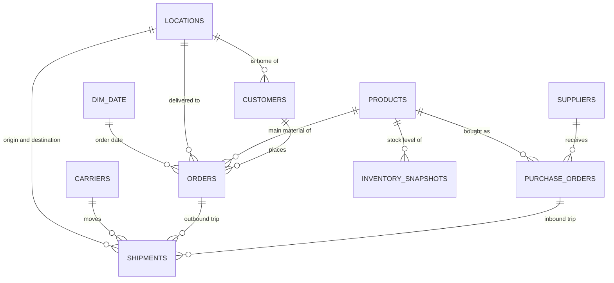

# Data model

## In MySQL: a normalised design (no repeated information)

## In Power BI: a "fact constellation" (galaxy schema)
Four fact tables at different levels of detail share one date table, so a single Year or Month slicer filters every chart.

| Fact table (one row per…) | Built from view |
|---|---|
| order | `vw_fact_orders` |
| shipment | `vw_fact_shipments` |
| purchase order | `vw_fact_purchase_orders` |
| product per month-end | `vw_fact_inventory` |

**Why views?** The views join the lookup tables and calculate fields such as `transit_hours`, `on_time_flag` and `lane` once, in SQL. Power BI then reads clean, ready-to-use tables, and the logic lives in one place.
