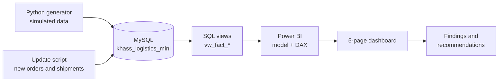

<div align="center">

# 🚚Khass Logistics Performance Dashboard

### How a printing business in Lapai got its deliveries **8 hours faster**, **18 points more on time** and **5% cheaper**, and how I built the proof from the foundation up.


**[📊 View the 5-slide portfolio](ADD-YOUR-CANVA-LINK-HERE)** · **[🧱 See how it was built](#-built-from-the-foundation-up)** · **[⚡ Run it in 5 minutes](#-run-it-in-5-minutes)**

</div>

---

## 👀 The 30-second story

**Problem.** Khass Designs and Prints prints in **Lapai**, but its materials come from **Lagos**, a long road trip away (Lagos → Lapai → Minna → Abuja). Slow trucks and untrusted suppliers made printing start late and orders arrive late.

**What I built.** A MySQL database, analysis queries and a 5-page Power BI dashboard that show *where* the delays happen and *why*, with every number checked between SQL and Power BI.

**Result.**

| What the owner cares about | Before (Jan–Jun 2024) | Now (Apr–Sep 2026) | Change |
|---|:---:|:---:|:---:|
| 🛣️ Lagos → Lapai delivery time | 26.0 h | **18.0 h** | **−8 h (−31%)** |
| ✅ Orders delivered on time | 64% | **82%** | **+18 points** |
| 💰 Logistics cost per order | ₦5,244 | **₦4,981** | **−5.0%** |
| 📦 Supplier fill rate | 73.6% | **96.6%** | **+23 points** |

> 🔎 **Why a recruiter should care:** this isn't a chart on a sample file. It's a full path from a business problem to a database, to a dashboard, to a recommendation, and the numbers reconcile at every step.

---

## 🖼️ Dashboard preview

| | |
|---|---|
|  |  |
|  |  |

<sub>Add your screenshots to `04-roof/screenshots/` (see the note in that folder). The data behind them is simulated.</sub>

---

## 🏗️ Built from the foundation up

Like a house, the project went up in stages. Open any folder to see that stage's work.

| Stage | Folder | What I built | Skills it shows |
|---|---|---|---|
| 🧱 **1. Foundation** | [`01-foundation`](01-foundation) | The business problem, 4 KPI definitions, data dictionary, data model (ERD) | Problem framing, data modelling |
| 🏗️ **2. Framework** | [`02-framework`](02-framework) | MySQL schema with keys and indexes, date table, INSERT scripts, compact dataset | SQL DDL, relational design |
| 🧱 **3. Walls** | [`03-walls`](03-walls) | Reporting views and one analysis query per KPI | Joins, CTEs, window functions, aggregation |
| 🏠 **4. Roof** | [`04-roof`](04-roof) | Power BI model, 40 DAX measures, 5-page dashboard, theme | Power BI, DAX, visual design |
| 🔑 **5. Move-in** | [`05-move-in`](05-move-in) | Key findings and recommendations, each with its reasoning | Insight, storytelling |
| 🔧 **6. Maintenance** | [`06-maintenance`](06-maintenance) | Scripts to add new data, 12 data-quality checks, refresh routine | Data operations, quality control |
| 🧰 **Extras** | [`extras`](extras) | Python data generator, full dataset (2,685 orders) | Python, pandas, reproducibility |

### The blueprint



---

## 💡 What the data says (with the reasoning)

1. **Deliveries are 8 hours faster.** The carriers average 27.9 h, 22.9 h and 17.4 h, and shipments timed to production days rose from 0% to 100%. *The gain came from carrier choice and planning.*
2. **More orders arrive on time.** Waiting for materials fell from about 52 h to about 21 h. *Fixing supply moved on-time delivery.*
3. **Each order costs 5% less to deliver.** I measured cost *per order* so growth in order numbers can't fake or hide a saving.
4. **Suppliers deliver more of what we ask for.** Orders placed with vetted, trusted suppliers went from 25% to 100%, and fill rate rose to 96.6%.

➡️ Full chain of reasoning and recommendations: [`05-move-in/insights.md`](05-move-in/insights.md)

---

## ⚡ Run it in 5 minutes

**You need:** MySQL 8.0+ and Power BI Desktop (Windows).

```bash
git clone https://github.com/<your-username>/khass-logistics-performance-dashboard.git
cd khass-logistics-performance-dashboard

mysql -u root -p < 02-framework/sql/01_mini_schema.sql
mysql -u root -p < 02-framework/sql/02a_mini_insert_dimensions.sql
mysql -u root -p < 02-framework/sql/02b_mini_insert_facts.sql
mysql -u root -p < 03-walls/sql/03_mini_views.sql
mysql -u root -p < 03-walls/sql/05_mini_analysis_queries.sql     # prints the headline numbers
```

Then connect Power BI: [`04-roof/connect-to-mysql.md`](04-roof/connect-to-mysql.md). No MySQL? Use the CSVs in [`04-roof/powerbi_csv_compact`](04-roof/powerbi_csv_compact).

**Add your own data:** [`06-maintenance`](06-maintenance).

---

## 🧰 Skills demonstrated

| Area | Evidence in this repo |
|---|---|
| **SQL / MySQL** | Schema design with foreign keys, CTEs, window functions, views, update scripts, data-quality checks |
| **Power BI** | Star and galaxy modelling, 40 DAX measures, time-window KPIs, conditional formatting, 5-page report |
| **Data validation** | SQL and Power BI results reconciled; real data errors found and fixed (see the commit history) |
| **Python** | Reproducible simulated data, calibrated to hit target KPIs |
| **Communication** | Findings explained in plain words, with the reasoning shown |

---

## ⚠️ An honest note about the data

All data is **simulated** for this portfolio project. It models a realistic improvement story, so the explanations show *how I reason*, not facts about a real company. I would rather say that plainly than overclaim.

---

<div align="center">

**Built by [Your Name]** · Data Analyst
[LinkedIn](ADD-LINK) · [Email](mailto:you@example.com) · [Canva portfolio](ADD-YOUR-CANVA-LINK-HERE)

</div>
