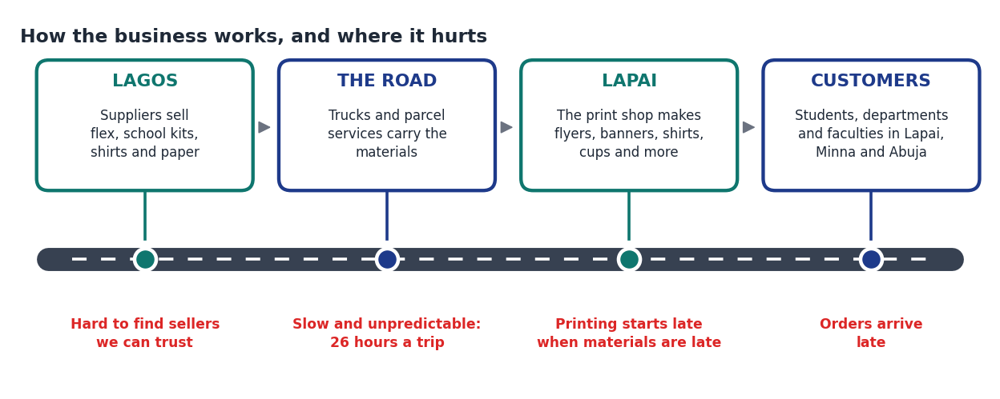
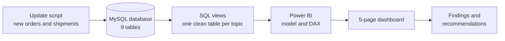
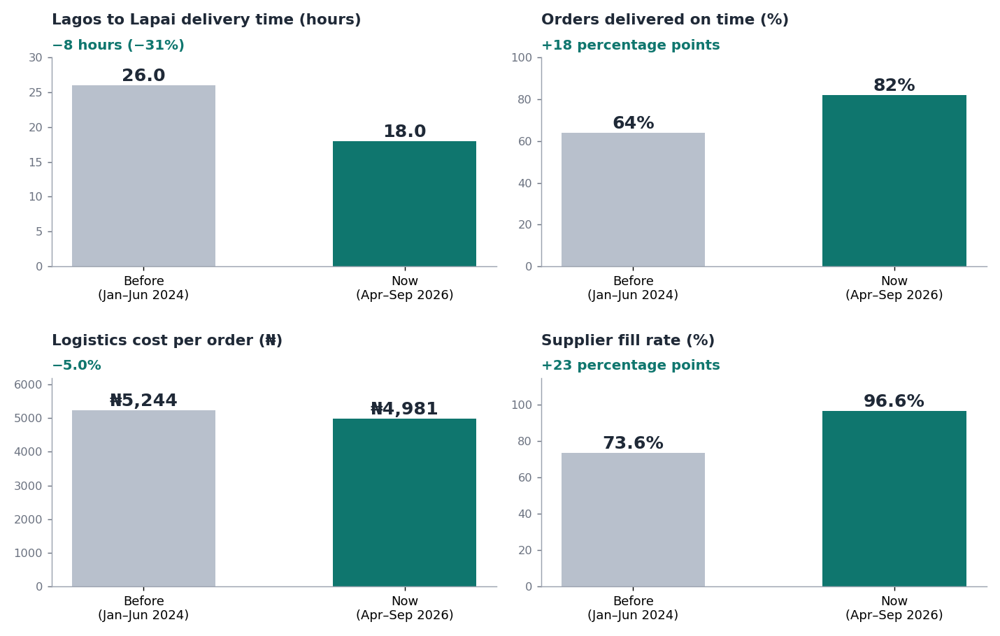
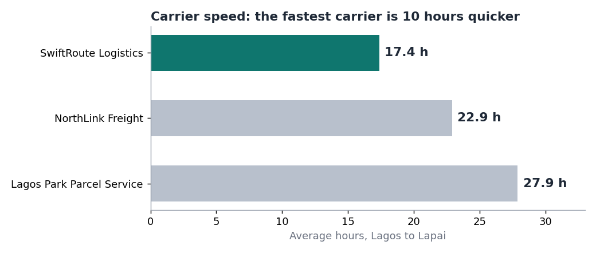
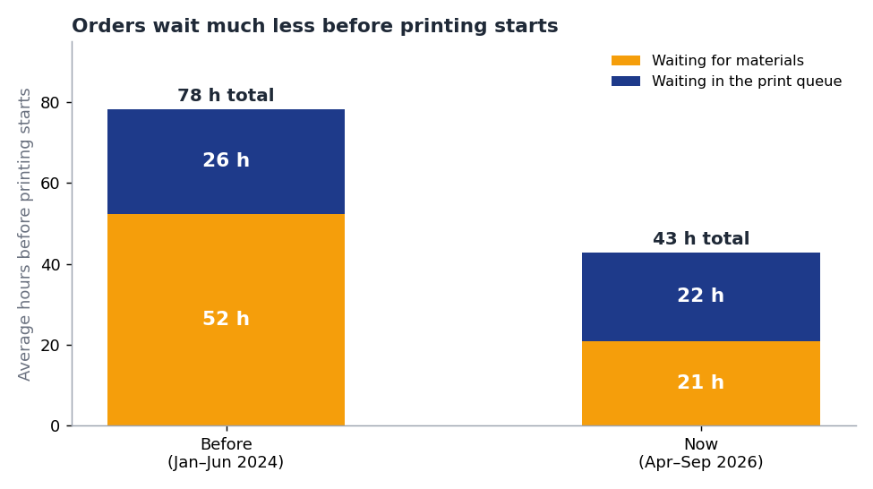
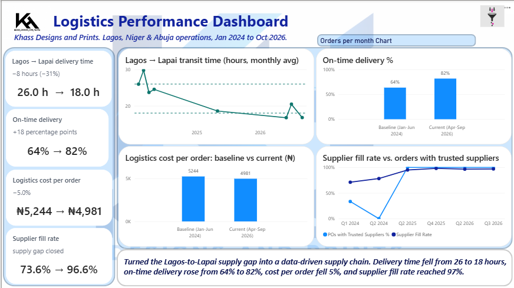
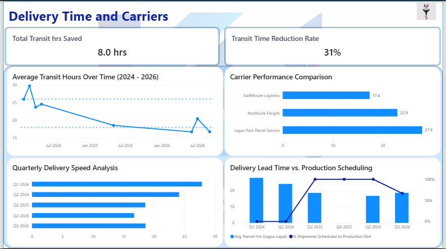
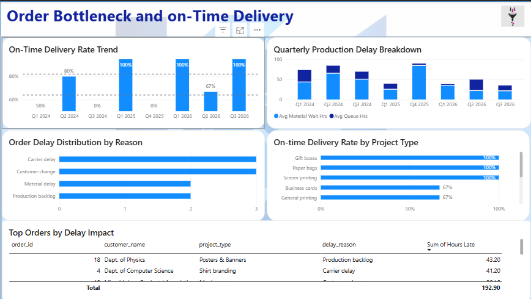
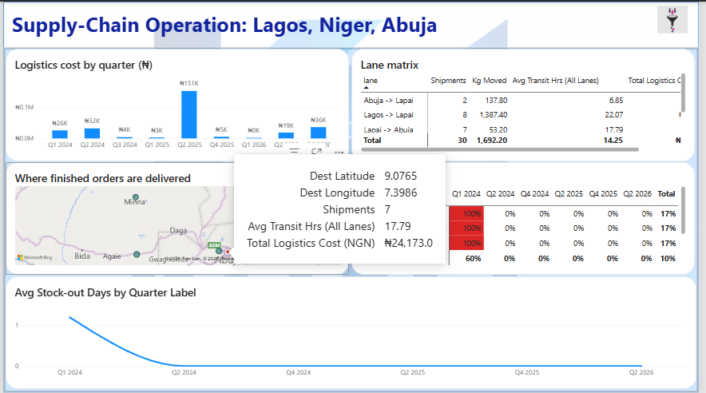

<div align="center">

<h1>&nbsp; Khass Logistics Performance Dashboard</h1>

**Tracks why a Lapai printing business gets its materials late from Lagos, finds the slow trucks and untrusted suppliers that delay printing and orders, and shows how to fix them with data.**


**[📊 View my portfolio](ADD-YOUR-CANVA-LINK-HERE)** · **[⚡ Run it in 5 minutes](#run-it-in-5-minutes)**

</div>

---

## **Logistics Performance Analysis: a KPI dashboard (descriptive and diagnostic analysis) for a printing business in Nigeria**

| | |
|---|---|
| **Type of analysis** | Descriptive (what happened) and diagnostic (why it happened). A baseline period is compared with a current period on four KPIs. |
| **Industry** | Logistics and supply chain · small print manufacturing, Nigeria |
| **Tools** | MySQL and Power BI |
| **Period covered** | January 2024 to October 2026 (sample data) |

---

## Executive summary

- **Business problem.** Khass Designs and Prints prints in Lapai, but its materials come from Lagos, a long road trip away. Slow trucks and untrusted suppliers made printing start late and orders arrive late.
- **Solution.** I built a MySQL database and a 5-page Power BI dashboard that compare Jan–Jun 2024 with Apr–Sep 2026 on four KPIs, then worked out *why* each one moved.
- **Impact.**

| KPI | Before | Now | Change |
|---|:---:|:---:|:---:|
| 🛣️ Lagos → Lapai delivery time | 26.0 h | **18.0 h** | **−8 h (−31%)** |
| ✅ Orders delivered on time | 64% | **82%** | **+18 points** |
| 💰 Logistics cost per order | ₦5,244 | **₦4,981** | **−5.0%** |
| 📦 Supplier fill rate | 73.6% | **96.6%** | **+23 points** |


---

## Business problem



**How the business works.** Khass Designs and Prints makes gift boxes, magic cups, branded shirts, flyers, posters and banners, business cards, invitation cards, paper bags, jotters and screen prints for student associations, departments, faculties and individuals. Most raw materials (flex, school kits, blank shirts, paper) are bought in **Lagos** and travel the long road to the print shop in **Lapai**. Finished orders go to customers in Lapai, Minna and Abuja.

**Where it hurts.**
- Trucks and parcel services were slow and unpredictable (about 26 hours from Lagos to Lapai).
- It was hard to find suppliers the business could trust.
- When materials arrive late, printing starts late, and the customer's order arrives late.

**Why I chose to solve it.**
- I live in Lagos and act as the middleman and Logistics Manager between the suppliers and the print shop, so I see these delays first-hand.
- Materials are the first step of **every** order. One fix at that step helps every order after it.
- The owner can feel the result directly: orders on time, customers happy, and money saved on each delivery.

---

## Methodology

**Approach:** KPI dashboard analysis. I compared a baseline period with a current period, then looked for the cause behind each change.

| Step | What I did | Where |
|---|---|---|
| 1. Frame | Wrote the problem, the four questions and exact KPI definitions | [`01-foundation`](01-foundation) |
| 2. Model | Designed the MySQL database: 9 tables, keys, a date table | [`02-framework`](02-framework) |
| 3. Query | Built reporting views and one analysis query per KPI | [`03-walls`](03-walls) |
| 4. Visualise | Built the Power BI model, 40 DAX measures and a 5-page dashboard | [`04-roof`](04-roof) |
| 5. Explain | Wrote findings and recommendations with the reasoning | [`05-move-in`](05-move-in) |
| 6. Maintain | Wrote scripts to add new data and 12 quality checks | [`06-maintenance`](06-maintenance) |



**How I measured each KPI** (the same in SQL and Power BI):
- **Delivery time:** hours from dispatch to arrival on the Lagos → Lapai lane.
- **On-time delivery:** the share of delivered orders that arrived by the promised time.
- **Cost per order:** shipping and handling cost divided by the number of orders, so growth in orders can't hide a saving.
- **Fill rate:** quantity received divided by quantity requested from suppliers.

Full definitions: [`01-foundation/kpi-definitions.md`](01-foundation/kpi-definitions.md). Data model: [`01-foundation/data-model.md`](01-foundation/data-model.md).

**About the data.** All data is **simulated** for this portfolio project. It models a realistic improvement story, so my explanations show *how I reason*, not facts about a real company.

### Run it in 5 minutes

You need MySQL 8.0 or later and Power BI Desktop.

```bash
mysql -u root -p < 02-framework/sql/01_mini_schema.sql
mysql -u root -p < 02-framework/sql/02a_mini_insert_dimensions.sql
mysql -u root -p < 02-framework/sql/02b_mini_insert_facts.sql
mysql -u root -p < 03-walls/sql/03_mini_views.sql
mysql -u root -p < 03-walls/sql/05_mini_analysis_queries.sql     # prints the headline numbers
```
Then connect Power BI with [`04-roof/connect-to-mysql.md`](04-roof/connect-to-mysql.md). No MySQL? Use the CSV files in [`04-roof/powerbi_csv_compact`](04-roof/powerbi_csv_compact).

---

## Skills

| Area | What I did in this project |
|---|---|
| **MySQL** | Database design with primary and foreign keys, joins, CTEs, window functions, views, scripts to insert and update data, data-quality checks |
| **Power BI** | Data modelling (four fact tables sharing one date table), 40 DAX measures, baseline-vs-current KPI logic, conditional formatting, a 5-page dashboard |
| **Analysis** | Defining KPIs, comparing periods, finding causes (carrier, scheduling, supplier vetting), checking results two ways |
| **Communication** | Explaining findings and recommendations in plain language for a business owner |

---

## Results and business recommendations

### The four KPIs



### Why deliveries got faster

| Carrier speed | Waiting before printing |
|---|---|
|  |  |

- **Carrier choice and planning made the trip faster.** The fastest carrier averages 17.4 h against 27.9 h for the slowest. Shipments timed to production days went from 0% to 100%.
- **Orders waited far less for materials.** Waiting for materials fell from about 52 h to about 21 h, so printing started sooner and more orders arrived on time.
- **Trusted suppliers delivered what we asked for.** Orders placed with vetted suppliers went from 25% to 100%, and fill rate rose to 96.6%.

### The dashboard

| | |
|---|---|
|  |  |
|  |  |

### Business recommendations

| # | Because… | I recommend… | I'd measure it by… |
|---|---|---|---|
| 1 | the fastest carrier averaged 17.4 h against 27.9 h | keeping that carrier and timing shipments to production days | average transit hours each month |
| 2 | trusted suppliers filled about 97% of requests | vetting every new supplier before large orders | fill rate by supplier |
| 3 | the only late reasons left in 2026 were print backlog and customer changes | aiming the next gains at the print schedule and clearer customer briefs | late orders by reason |
| 4 | single months have only a few orders and look jumpy | judging results over six-month periods | the same two periods every time |

More detail and the full reasoning: [`05-move-in/insights.md`](05-move-in/insights.md).

---

## Next steps

**Limitations I would fix**
- **Use real data.** The data here is simulated, so the next step is to load the company's own orders, shipments and supplier records.
- **Add more orders.** The compact sample has 28 orders, so quarterly percentages rest on very few. A year or more of real orders would make monthly trends reliable.
- **Compare like with like.** Supplier fill rate adds up different units (litres, packs, pieces). I would measure it per product, or by value in naira.

**What I would work on with more time**
- Set up an automatic refresh so the dashboard updates itself when new rows are added.
- Add cost per kilogram by route and carrier, to see which road is worth its price.
- Track how late orders are, not just whether they are late, and add customer feedback to test whether "on time" matches what customers feel.
- Add a forecast of delivery times, so the owner can plan production days ahead.
- Design a phone-friendly page so the owner can check the numbers on the move.

---

<div align="center">

**Built by Julde Toheed** · Data Analyst
[LinkedIn](www.linkedin.com/in/julde-toheed) · [Email](mailto:juldetoheed@gmail.com) · [Portfolio](https://canva.link/sl2tsx4x0eob9ot)

</div>
